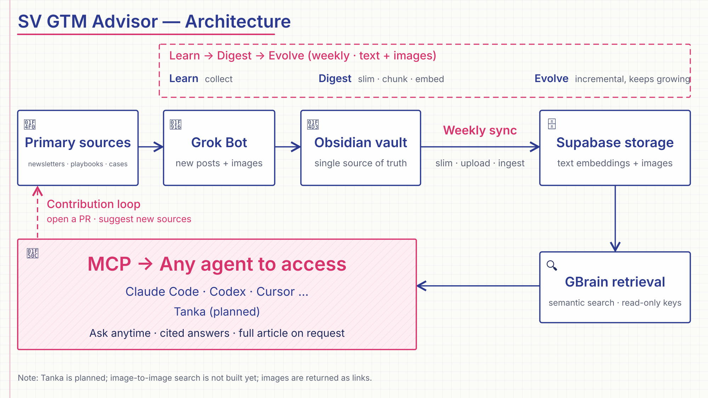

# SV GTM Advisor

**English** · [中文](README.zh-CN.md)

A self-updating Silicon Valley GTM advisor that plugs into **Claude Code, Codex, or any MCP-capable agent**.
Ask a go-to-market question and it first searches 1,600+ first-hand growth write-ups for the cases closest
to your situation, then answers from the original text and tells you exactly which article it came from.

> **You don't need to clone this repo or write code.** Setup takes about two minutes. Just follow the steps below.
> The MCP server is registered as `gtm-brain` on your machine (the repo was renamed; existing installs keep working).

---

## Why this exists

**Nobody's experience covers every new challenge.** Launching to B2B buyers, cold-starting a developer API,
getting 10× in consumer, breaking into a new country: every launch raises different questions.
LinkedIn outbound, paid ads, or creators? How do you get company info from new sign-ups? How do you turn them into
daily users? Smart people on the same team often disagree, and what's "obviously true" to one person makes no sense to another.

**The answer usually hides in the details.** The same creator's genuine recommendation of Manus drew 2.8M views,
while a polite repost of Devin got about 20 likes. Without first-hand cases, it's hard to say why.

**General-purpose models help, but they aren't precise.** Their knowledge comes mostly from older, public material.
They know a little about everything and give you the generic playbook (build community, write content, launch on Product Hunt).
Every item is reasonable, but none of it tells you **which one will backfire in your situation**.

**The most valuable know-how lives in first-hand sources.** What matters most in GTM is what comparable companies did in
the past year, sometimes the past few months: how Gamma worked with creators, how Lovable grew its community,
how Descript drove UGC. That knowledge sits in paid newsletters and operator blogs like Lenny's Newsletter
and Elena's Growth Scoop.

**No human can read it all.** Reading these sources pays off enormously, but nobody can read thousands of posts,
remember them precisely, and recall the right one at the right moment. That part needs AI.

So you need two things: **an AI that tirelessly learns the newest useful material and applies it where it fits**,
and **a way to spread one person's hard-won lessons to everyone doing GTM** so the whole team works from the same evidence.

That's SV GTM Advisor. It points you in a direction and shows you the evidence. **It doesn't do the work for you**:
it won't write copy, run ads, or send emails. Its job is to make sure that before you act, you know where
others have already stepped on the rake.

---

## What's in the library

All sources are first-hand GTM practice. **Synced every Saturday**; new sources are added over time.

> **Last sync**: 2026-11-14 11:45 PT · **1,825** notes in total (images synced).

| Source | Articles | Span | Good for |
|---|---|---|---|
| **Lenny's Newsletter** | 525 | 2019 – now | Product, growth, PLG, pricing, teams & careers; lots of interviews and data |
| **Growth Unhinged** | 247 | 2021 – now | B2B SaaS growth in practice: free trials, pricing, PLG conversion, metrics |
| **Marketing Ideas** | 205 | 2023 – now | Concrete weekly marketing plays and examples you can use right away |
| **Fletch PMM** | 137 | — | **Website positioning before/after teardowns**, with full-page screenshots |
| **MRR Unlocked** | 129 | 2021 – now | Founder-led early GTM: cold email, LinkedIn, sales demos, positioning worksheets |
| **Behind the Craft** | 121 | 2016 – now | Peter Yang on building AI products, using AI tools, and growing as a PM |
| **Elena's Growth Scoop** | 64 | 2023 – now | Elena Verna on PLG, freemium, pricing, and growth teams in the AI era |
| **MKT1** | 43 | 2020 – now | Emily Kramer on B2B marketing: Claude / MCP workflows, team and strategy |
| **Growth Memo** | 35 | 2018 – now | Kevin Indig on SEO and AI search: ranking factors, content strategy, AI traffic shifts |
| **GTM Strategist** | 8 | 2026 – now | Maja Voje on B2B GTM: viral launches, LinkedIn, ads and referrals |
| **Playbooks** | 268 | — | Structured playbooks (incl. PR: newsjacking, Chuwu-PR-OS): pricing, launches, GEO, PR & crisis |
| **Case studies & industry notes** | 23 | 2024 – now | Single-company GTM breakdowns (e.g. Meshy, Corgi, viral launches on X) |
| **Product** | 20 | 2026 – now | Product notes on AI / agents and startup gaps |

Images in the articles (charts, screenshots, frameworks) are kept and returned as clickable links.
**Ask in Chinese and it still finds English articles.**

**Not in the library**: breaking news, any company's internal data, topics outside GTM.
For those it tells you the library has nothing and falls back to the model's own knowledge or web search.

---

## How it works



- **Learn**: a scheduled Grok Bot routine collects new posts from GTM newsletters several times a week,
  plus relevant playbooks and case studies from X, with original images.
- **Normalize**: everything lands in an Obsidian vault as Markdown, the single source of truth.
  Sync is incremental, so a missed run never loses content.
- **Digest**: built on Garry Tan's open-source [GBrain](https://github.com/garrytan/gbrain). Text is chunked and embedded,
  images are slimmed, and both are stored in Supabase. Answers link the original images so the agent can look at them.
- **Serve over MCP with managed access**: one-command install for Claude Code and Codex; any MCP client works through
  the bundled stdio bridge. Each person gets their own **read-only** credential.
- **Contribute**: the code is open. PRs with new sources or features feed into the next weekly update,
  so everyone's advisor gets better together.

---

## Example: the same question, with and without the library

**Question**: how should an AI product do its cold start?

**Without the library**, the typical answer is: build a great product, launch on Product Hunt and X, give a generous free
tier, then figure out monetization. Not wrong, but no companies, no numbers, and nothing about where it goes wrong.

**With SV GTM Advisor**, the answer is grounded in specific articles:

- **Don't copy SaaS free tiers.** In Lenny's Newsletter, *Why SaaS freemium playbooks don't work in AI, and what to do instead*,
  a Google AI product lead explains that every free AI call burns compute, yet the free tier must still deliver the "magic"
  or users never reach the aha moment. Their lesson: tiering by usage intensity beats charging by model intelligence.
- **Launches spread when they're reproducible.** The *ai-launch-playbook* compares Manus and Devin (the source of the
  2.8M views vs. ~20 likes contrast): users could re-create Manus's demos themselves. Then plan the relay:
  X → YouTube / Substack → Reddit / HN.
- **Timing beats persistence.** Growth Unhinged, *How Bolt.new hit $40M ARR in 5 months*, warns against reading Bolt's breakout
  as "keep going and it'll grow". The key was having the right tech the moment model capability matured.

Every point above comes from an actual search of the library and links back to the original article.

<details>
<summary>A longer side-by-side: open-source AI infra cold start</summary>

**Question**: an open-source AI memory layer (Apache 2.0 + hosted cloud, free tier of 50K credits, Pro at $25/mo,
no public customer case studies yet). How should it cold-start?

Same model (Claude Opus 5), same question; the only difference is whether gtm-brain was connected.
The right column is a real retrieval from 2026-09-22.

| | Without the library | With the library |
|---|---|---|
| **Open source → paid cloud** | "Build the open-source community first, then funnel to the cloud." | Cockroach Labs was open source from day one and only later added a proprietary self-hosted edition and a dedicated cloud. The founder warns that **enterprise security and compliance stretch sales cycles by months**, so run community and enterprise sales as two parallel tracks · [source](https://www.growthunhinged.com/p/scaling-to-5b-with-cockroach-labs) |
| **Setting the free tier** | "Be generous, watch usage, then decide what to charge for." | In SaaS an extra free user costs almost nothing; **in AI every free call burns GPU**. Size the free tier from real per-user compute cost × conversion rate, not from SaaS norms · [source](https://www.lennysnewsletter.com/p/why-saas-freemium-playbooks-dont) |
| **First 10 customers** | "Write technical blogs, post on Hacker News, integrate with LangChain." | 20+ fast-growing B2B companies relied on three levers: **personal networks, going where customers gather, and press**. Figma's Dylan Field shortlisted the most influential designers on Twitter, then cold-emailed or asked for intros · [source](https://www.lennysnewsletter.com/p/how-todays-fastest-growing-b2b-businesses) · [more](https://www.lennysnewsletter.com/p/how-to-win-your-first-10-b2b-customers) |
| **Which features to give away** | "Go free first, monetize later." | There's a method to choosing which features to give away · [source](https://www.growthunhinged.com/p/why-you-should-give-away-your-features) |
| **Cold-start budget** | Not mentioned | 2026 benchmarks: ~$1K bought a few hundred sign-ups (small YouTube ads + ~20 niche subreddits + DM flow); ~$5K reached 1,800 upvotes in 24h, but one launch had its #1 spot revoked after review, so read the platform rules before spending |
| **Bottom line** | Reasonable but generic: no real companies, no numbers, no sources, and nothing about what backfires | Who did what, where it went wrong, what the numbers were, each one clickable back to the original |

The key row is the second one: "AI free tiers burn GPU" comes from a May 2026 article, **something the model may not know
or think to bring up**, and exactly what you need before setting a free tier.

Both columns are real outputs. We did not make the left column worse on purpose.

</details>

---

## Get access

The code here is public, but **the knowledge service is only open to people Bei has set up**: Bei and a few
teams he works with, for internal, non-commercial use. **Message Bei (Bei Zhang, GitHub [@beizhangnina](https://github.com/beizhangnina))**
with your English first name (e.g. `alice`).

He'll send you a file: **`<your-name>-install.sh`**.

- It's **for you only** and contains your personal credential. **Don't forward it** or put it in group chats, email, cloud drives, or git.
- The credential is **read-only**: it can search and read, never modify the library.
- Usually sent by AirDrop or DM. **Delete the message once you've installed.**

---

## Install (once, about two minutes)

**You need** Claude Code or Codex (the one inside the ChatGPT desktop app). The `python3` that ships with macOS is enough
(Python 3.7+ works); nothing else to install.

1. Open the **Terminal** app on your Mac.
2. Go to the folder with the install file, e.g. Downloads:
   ```bash
   cd ~/Downloads
   ```
3. Run it (replace `alice` with your name):
   ```bash
   bash alice-install.sh
   ```
4. You're done when you see:
   ```
   ✓ 完成，已装进 Claude Code 和 Codex。
   ```
   (only the tool(s) you have installed will be listed)

> Run it in the Terminal app, not inside a Claude Code chat.

**What it does** (only on your machine, and only the gtm-brain parts; nothing else in your config is touched):

- Stores the credential in `~/.config/gtm-brain/`, readable only by you
- Registers the server with Claude Code and/or Codex, whichever you have
- Adds a rule to `~/.claude/CLAUDE.md` / `~/.codex/AGENTS.md`: **check this library first for GTM questions, and fetch the full article when asked**
- Renews the credential automatically, so **you never have to touch it again**

**Other MCP clients** (Cursor, Claude Desktop, …): point them at the local bridge,
`python3 ~/.config/gtm-brain/stdio_bridge.py`, as a stdio MCP server.

---

## Usage

**Restart first**: open a new Claude Code session; for Codex, **fully quit and reopen the ChatGPT app**.

Then **just ask, in English or Chinese**. A few examples and what it finds:

| You ask | What it finds (tested) |
|---|---|
| Give me three good B2B SaaS homepage positioning rewrites and explain before vs. after | Fletch PMM teardowns of Survicate, lemlist, Blue Triangle |
| How do I improve free-trial conversion? | Growth Unhinged on free-trial optimization and reverse trials; MRR Unlocked's 8 free-trial tips |
| How should I approach pricing? | Growth Unhinged's pricing-project method, the Playbooks pricing guide, Lenny's on B2B growth engines |
| What should I prepare before a launch? | Playbooks on launch strategy and Product Hunt |

> **Do I need to say "gtm-brain"?** No, the install rule makes the agent check the library for GTM questions.
> But it sometimes decides a question doesn't need it. **To guarantee a lookup, add "use gtm-brain"**, e.g.
> "Use gtm-brain: how do I improve free-trial conversion?"

**You get** answers grounded in the original text, with sources (series + article title) and image links where useful.
Each lookup takes about 4–6 seconds.

**Want the whole article?** Just ask: "show me the full text of that Bolt.new article". The agent fetches it with `get_page`
and shows the complete original.

**The more specific the question, the better the answer.** Some good ones:

- "How do PLG companies add a sales team? What did ClickUp and Calendly do?"
- "How should we approach AI search / GEO? Give concrete steps."
- "Look at Fletch PMM's fintech teardowns and summarize the common problems."
- "How should we define activation? List the relevant articles with a one-line summary each."

To confirm it's connected: in Claude Code, type `/mcp` and look for **gtm-brain ✔ connected**.

---

## Troubleshooting

| Symptom | Fix |
|---|---|
| Install says it can't get a token (「凭证换不到 token」) | Your credential may be revoked or expired. Ask Bei for a new install file |
| Install says it found neither Claude Code nor Codex | Install one of them, then rerun the install file |
| `CERTIFICATE_VERIFY_FAILED` (common with python.org Python) | Update the client scripts (below); they now fall back to the macOS system certificates |
| Codex / Cursor can't connect, or Python shows `TypeError: unsupported operand type(s) for \|` | Old bridge on macOS's built-in Python 3.9. Update the client scripts (below), then restart the app |
| The agent answers without checking the library | 1) add "use gtm-brain" to your question; 2) make sure you restarted (new session / reopened app); 3) run `/mcp` in Claude Code to check it's connected |
| The agent only gives excerpts when you want the full article | Update the client scripts (below) to get the new rule, start a new session, and ask for "the full text" |
| Anything else | Run `python3 ~/.config/gtm-brain/headers.py` in Terminal and send Bei the output (it doesn't print your secret) |
| New computer | Run the same install file again on the new machine |
| Leaving / no longer need it | Tell Bei; he'll revoke your credential immediately |

**Update the client scripts** (keeps your credential; safe to rerun):

```bash
D=~/.config/gtm-brain; curl -fsSL --output-dir "$D" --remote-name-all "https://raw.githubusercontent.com/beizhangnina/sv-gtm-advisor/main/client/{headers.py,stdio_bridge.py,install_rule.py,claude-md-rule.md}" && { [ ! -d ~/.claude ] || python3 "$D/install_rule.py" "$D/claude-md-rule.md" ~/.claude/CLAUDE.md; } && { [ ! -d ~/.codex ] || python3 "$D/install_rule.py" "$D/claude-md-rule.md" ~/.codex/AGENTS.md; }
```

Then start a new Claude Code session, or fully restart the ChatGPT app for Codex.

---

## Usage policy

This is an **internal tool**: not offered publicly, not for commercial use. The library includes **paid subscription content**
(Lenny's and others); copyright stays with the original authors.

- **Reading full articles inside your own agent session is fine.** That's what the tool is for.
- **Don't redistribute** article text or image links outside the team: no social media, public docs, or external materials.
- Install files and credentials are for you only.

More detailed install notes (how it works, what each step does): [docs/INSTALL-FOR-TEAMMATES.md](docs/INSTALL-FOR-TEAMMATES.md) (Chinese)

## Contributing

Suggestions for new sources and PRs for new features are welcome. Every contribution lands in the next weekly update.
To edit the architecture diagram, change `docs/images/gen_architecture.py` and run
`python3 docs/images/gen_architecture.py docs/images` to regenerate both language versions.
