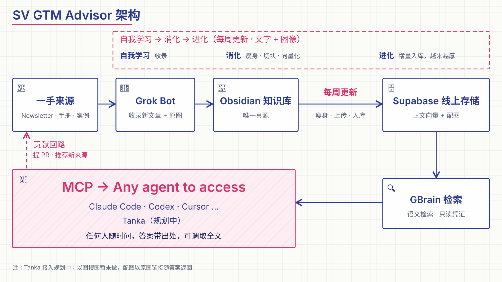

# SV GTM Advisor

[English](README.md) · **中文**

一个会自我更新的硅谷 GTM 顾问，接进你的 **Claude Code、Codex 或任何支持 MCP 的 Agent**。
问一句 GTM 问题，它先去 1,600 多篇一手增长复盘里找最接近你处境的案例，再基于原文回答，并告诉你出自哪篇。

> **你不需要 clone 这个仓库，也不需要懂代码。** 装好只要两分钟，照下面做就行。
> 服务在你电脑上注册的名字仍是 `gtm-brain`（仓库改过名，已经装好的人不受影响）。

---

## 为什么做这个

**没有人的经验能覆盖所有新挑战。** 要拿下 B 端客户、开发者 API 怎么冷启动、C 端怎么做到十倍增长、
怎么进入一个新国家，每次发布遇到的问题都不一样：用 LinkedIn outbound，还是 paid ads 或 KOL？
怎样跟新注册的用户沟通，拿到他们的公司信息？怎样把他们变成高频用户？
同一个团队里，大家对同一件事的理解也可能差别很大：A 觉得是常识，B 却觉得说不通。

**答案往往藏在细节里。** 同一位创作者，真心推荐 Manus 带来 280 万次浏览，礼貌帮转 Devin 却只有约 20 个赞。
差别在哪？没有一手案例，很难说清。

**大模型有帮助，但不够准。** 它的知识多来自过去的公开资料，什么都懂一点，给的是**通用套路**：
做社区、写内容、发 Product Hunt。每条都对，但都不知道**你这个处境下哪条会翻车**。

**最值钱的经验藏在一手来源里。** GTM 最有价值的，是同行最近一年、甚至最近几个月在类似产品上的打法：
Gamma 怎样做 KOL、Lovable 怎样做社区增长、Descript 怎样做 UGC。这些打法多半沉淀在付费 newsletter
和增长专家的 blog 里，比如 Lenny's Newsletter、Elena's Growth Scoop。

**人脑读不过来。** 订阅和阅读这些内容对工作帮助巨大，但人不可能天天读上千篇、精准记住，
还在用得上的时候想起来、用到最相关的地方。这一步得靠 AI。

所以需要两样东西：**一个不知疲倦、持续学习最新有用内容并用到合适场景的 AI**；
**一种能把一个人的经验高效传给所有做 GTM 的人的方式**，让整个团队基于同一套证据对齐认知。

这就是 SV GTM Advisor。它指方向、给证据，**但不替你执行**：不写文案、不跑广告、不发邮件。
它只负责让你在动手之前，先站在「别人已经踩过这个坑」的位置上。

---

## 库里有什么

全是一手的 GTM 实操内容。**每周六同步更新**；新来源会陆续加进来。

> **最近一次同步**：2026-11-14 11:45 PT · 库内合计 **1,825** 篇笔记（配图已同步）。

| 来源 | 篇数 | 时间跨度 | 适合找什么 |
|---|---|---|---|
| **Lenny's Newsletter** | 525 | 2019 – 至今 | 产品、增长、PLG、定价、团队与职业；大量访谈和数据 |
| **Growth Unhinged** | 247 | 2021 – 至今 | B2B SaaS 增长实操：免费试用、定价、PLG 转化、指标 |
| **Marketing Ideas** | 205 | 2023 – 至今 | 每周具体的营销打法和案例，拿来就能用的点子 |
| **Fletch PMM** | 137 | — | **网站定位改版前后对比**：改之前哪里不好、改之后好在哪，附整页截图 |
| **MRR Unlocked** | 129 | 2021 – 至今 | 创始人视角的早期 GTM：冷邮件、LinkedIn、销售演示、定位工作表 |
| **Behind the Craft** | 121 | 2016 – 至今 | Peter Yang 的产品与 AI 实战：AI 产品怎么做、怎么用 AI 工具、产品经理成长 |
| **Elena's Growth Scoop** | 64 | 2023 – 至今 | Elena Verna 的增长方法：PLG、免费增值、定价、AI 时代的增长团队 |
| **MKT1** | 43 | 2020 – 至今 | Emily Kramer 的 B2B 营销实操：Claude / MCP 工作流、团队与策略 |
| **Growth Memo** | 35 | 2018 – 至今 | Kevin Indig 的 SEO 与 AI 搜索：排名因素、内容策略、AI 搜索流量变化 |
| **GTM Strategist** | 8 | 2026 – 至今 | Maja Voje 的 B2B GTM：病毒发布、LinkedIn、广告与推荐 |
| **Playbooks** | 268 | — | 成体系的手册（含 PR：newsjack、Chuwu-PR-OS）：定价、发布、GEO、公关与危机 |
| **案例拆解与行业观察** | 23 | 2024 – 至今 | 单家公司的 GTM 拆解（如 Meshy、Corgi、X 上的爆款发布） |
| **Product** | 20 | 2026 – 至今 | AI / Agent 方向的产品观察与创业缝隙 |

文章里的配图（图表、截图、框架图）都保留着，以可点开的链接返回。**中文提问也能搜到英文文章。**

**库里没有的**：实时新闻、某家公司的内部数据、GTM 以外的话题。
问到这些，它会明确说库里没有，再用模型自身知识或网络补充。

---

## 怎么运作



- **定期学习**：Grok Bot 的定时任务每周多次抓取 GTM newsletter 的最新内容，并补充 X 上相关的 playbook 和案例，连原图一起收录。
- **转成 Markdown**：内容存进 Obsidian 知识库，统一成 Markdown，这里是唯一的内容源头。增量更新，漏跑一次也不丢内容。
- **解析入库**：基于 Garry Tan 开源的 [GBrain](https://github.com/garrytan/gbrain)，把正文切块、生成向量，配图瘦身后一并存入 Supabase。
  回答时附上原图链接，Agent 可以直接看图。
- **MCP 打包，统一管理权限**：Claude Code、Codex 一键安装；其他 MCP 客户端通过自带的 stdio 桥接接入。每人一套**只读**凭证。
- **代码开源，欢迎贡献**：欢迎提 PR 贡献新来源和新功能，每一次贡献都会进入下一轮更新，让所有人的顾问一起变强。

---

## 举个例子：同一个问题，接不接库的差别

**问题**：AI 产品冷启动怎么做？

**不查库时**，典型的回答是：先把产品做好，发 Product Hunt 和 X，免费额度给足吸引用户，再慢慢找付费点。
方向没错，但没有公司、没有数字，也没说哪里会踩坑。

**接入 SV GTM Advisor 后**，答案落到了具体的文章和案例上：

- **免费额度不能照抄 SaaS**：Google AI 产品负责人在 Lenny's Newsletter《Why SaaS freemium playbooks don't work in AI,
  and what to do instead》中指出，AI 产品的免费用户每次调用都在消耗算力，但又必须给足「魔法」，用户才会迎来惊艳时刻（aha moment）。
  他们的经验是：按使用强度分档，比按模型聪明程度收费更有效。
- **发布靠可复现**：Playbook《ai-launch-playbook》复盘了 Manus 与 Devin，280 万次浏览与约 20 个赞的对比就出自这里。
  关键在于用户能自己复现 Manus 的演示；之后再由 X → YouTube / Substack → Reddit / HN 接力传播。
- **时机比坚持重要**：Growth Unhinged《How Bolt.new hit $40M ARR in 5 months》提醒，不要把 Bolt.new 的爆发读成
  「一直做下去就会增长」，关键在于模型能力成熟时，团队手里恰好有对的技术。

以上依据均来自对库的实际检索，每条都能点开原文核对。

<details>
<summary>展开看一个更完整的对比：开源 AI 基础设施产品的冷启动</summary>

**问题**：一个开源的 AI 记忆层产品（Apache 2.0 开源 + 托管云服务，免费版 5 万额度，Pro $25/月，官网还没有公开客户案例），**该怎么做冷启动？**

同一个模型（Claude Opus 5），同一个问题，唯一的区别是有没有接 gtm-brain。右栏是 2026-09-22 的真实检索结果。

| | 不接库 | 接了库 |
|---|---|---|
| **开源怎么转成付费云** | 「先把开源社区做起来，再引导到云服务」 | Cockroach Labs 是一开始就开源，之后才加自托管专有版和专用云。创始人提醒：**企业段的安全合规和销售周期比预期长好几个月**，社区和企业销售要两条线并行，别指望社区自然转化 · [出处](https://www.growthunhinged.com/p/scaling-to-5b-with-cockroach-labs) |
| **免费额度怎么定** | 「免费额度给足，观察用户怎么用，再决定付费点」 | 传统 SaaS 多一个免费用户成本近似为零，**AI 每次免费调用都在烧 GPU**，免费额度给不对会烧穿现金。要按「单个免费用户的真实计算成本 × 转化率」倒推，不能照抄 SaaS · [出处](https://www.lennysnewsletter.com/p/why-saas-freemium-playbooks-dont) |
| **前 10 个客户从哪来** | 「写技术博客发 Hacker News、接 LangChain 生态借分发」 | 二十多家高速增长的 B2B 公司靠的是三条杠杆：**个人网络、去客户扎堆的地方找、拿到媒体报道**。Figma 的 Dylan Field 先在 Twitter 上筛出最有影响力的设计师，再逐个冷邮件或要引荐 · [出处](https://www.lennysnewsletter.com/p/how-todays-fastest-growing-b2b-businesses) · [更细的打法](https://www.lennysnewsletter.com/p/how-to-win-your-first-10-b2b-customers) |
| **免费送哪些功能** | 「先免费引流，再想变现」 | 送哪些功能是有方法的，不是「先免费再说」 · [出处](https://www.growthunhinged.com/p/why-you-should-give-away-your-features) |
| **冷启动要花多少钱** | 没提 | 2026 年基准：约 $1K 换来几百个注册（小额 YouTube 广告 + 二十来个细分 subreddit + 私信流程）；约 $5K 可冲到 24 小时 1,800 票，但有案例当天第一被事后复核撤销——花钱前先看清平台规则 |
| **一句话总结** | 每条都对，但都是通用套路：没有真实公司、没有数字、没有出处，也不会告诉你哪条会翻车 | 具体公司怎么做的、哪一步会踩坑、数字是多少，每条都能点开原文核对 |

最关键的是第二行：「AI 的免费额度会烧 GPU」来自 2026 年 5 月的一篇文章，**是模型自身知识里不一定有、也不一定会主动提起的**，
而这恰恰是定免费额度时最该先知道的事。

两边都是真实输出，我们没有刻意把左栏写差。

</details>

---

## 找 Bei 开通

这个仓库的代码是公开的，但**知识库服务只对 Bei 开通了的人开放**：Bei 自己和合作的几个团队，内部使用、不做商用。
**私信 Bei（Bei Zhang，GitHub [@beizhangnina](https://github.com/beizhangnina)）**，告诉他你的英文名（比如 `alice`）。

他会发你一个文件：**`你的名字-install.sh`**。

- 这是**只给你一个人用的**：里面有你的个人凭证。**别转发，也别放进群聊、邮件、网盘或 git。**
- 凭证是**只读**的：只能搜和读，改不了库里的东西。
- 通常是 AirDrop 或私聊发给你。**装好之后把那条消息删掉。**

---

## 安装（一次，约两分钟）

**需要**：装了 Claude Code 或 Codex（ChatGPT 桌面 App 里那个）其中之一。Mac 自带的 `python3` 就够（Python 3.7 以上都行），不用装别的。

1. 打开 Mac 的 **「终端」（Terminal）** App
2. 进入安装文件所在的文件夹，比如下载目录：
   ```bash
   cd ~/Downloads
   ```
3. 运行（把 `alice` 换成你的名字）：
   ```bash
   bash alice-install.sh
   ```
4. 看到这句就装好了：
   ```
   ✓ 完成，已装进 Claude Code 和 Codex。
   ```
   （只装了其中一个的话，就只显示那一个）

> 必须在「终端」里运行，不要在 Claude Code 的对话框里跑。

**它做了什么**（只动你自己电脑，而且只动 gtm-brain 相关的那一段，不碰你其他的配置）：

- 把凭证存到 `~/.config/gtm-brain/`，只有你自己能读
- 装了 Claude Code 就配进 Claude Code，装了 Codex 就配进 Codex，两个都有就两个都配
- 在 `~/.claude/CLAUDE.md` / `~/.codex/AGENTS.md` 里加一条规则：**问 GTM 问题时自动先查这个库，要全文时取回完整原文**
- 凭证会自动续期，**装一次就永远不用管**

**其他 MCP 客户端**（Cursor、Claude Desktop 等）：把 `python3 ~/.config/gtm-brain/stdio_bridge.py` 配成一个 stdio MCP 服务即可。

---

## 怎么用

**先重启一次**：新开一个 Claude Code 会话；用 Codex 的话，**彻底退出并重新打开 ChatGPT App**。

然后**直接用中文或英文问就行**。几个例子，以及你大概会看到什么：

| 你问 | 它会去找的（实测结果） |
|---|---|
| B2B SaaS 首页定位有哪些好的改版案例？给我三个，说说改前改后的区别 | Fletch PMM 的 Survicate、lemlist、Blue Triangle 等改版前后对比 |
| 免费试用怎么优化转化？ | Growth Unhinged 的免费试用优化、reverse trial 指南，MRR Unlocked 的免费试用 8 条要点 |
| 定价策略怎么做？ | Growth Unhinged 的定价项目方法、Playbooks 的定价策略手册、Lenny's 的 B2B 增长引擎 |
| 产品发布前要准备什么？ | Playbooks 的发布策略和 Product Hunt 发布指南 |

> **要不要说「gtm-brain」？** 不说也行：安装时已经加了规则，问 GTM 相关的问题它会自动先查库。
> 但它有时会判断「这题不用查」而直接凭自己的知识回答。**想确保它一定先查库，就在问题里加一句「用 gtm-brain」**，
> 比如「用 gtm-brain 查一下，免费试用怎么优化转化？」

**你会得到**：基于原文的回答，带出处（系列 + 文章标题），需要时附上原文里的图片链接。每次查库大约 4–6 秒。

**想看整篇原文？** 直接说「把那篇 Bolt.new 的文章全文给我」，Agent 会用 `get_page` 取回并完整展示。

**问得越具体，答得越好**。几个好用的问法：

- 「PLG 公司怎么加上销售团队？ClickUp、Calendly 这些是怎么做的」
- 「AI 搜索 / GEO 应该怎么做？有哪些具体步骤」
- 「Fletch PMM 里 fintech 公司的改版案例，总结它们共同的问题」
- 「activation 指标怎么定？列出相关文章，每篇一句话总结」

想确认它连上了：在 Claude Code 里输入 `/mcp`，列表里有 **gtm-brain ✔ connected** 就对了。

---

## 遇到问题

| 现象 | 怎么办 |
|---|---|
| 安装时报「凭证换不到 token」 | 凭证可能已经失效。找 Bei 重新发一个安装文件 |
| 安装时报「没找到 Claude Code 也没找到 Codex」 | 先装其中一个，再重新运行安装文件 |
| 报 `CERTIFICATE_VERIFY_FAILED`（python.org 安装包版的 Python 常见） | 更新本地脚本（见下）；新脚本会自动用 macOS 系统证书 |
| Codex / Cursor 连不上，或 Python 报 `TypeError: unsupported operand type(s) for \|` | 旧版桥接脚本不兼容 Mac 自带的 Python 3.9。更新本地脚本（见下），然后重启 App |
| Claude / Codex 回答时没有去查库 | 1）问题里加一句「用 gtm-brain」；2）确认重启过（新会话 / 重开 App）；3）Claude Code 里输入 `/mcp` 看是否 connected |
| 想看全文，Agent 却只给摘要 | 更新本地脚本（见下）拿到新规则，新开一个会话，明确说「给我全文」 |
| 其他报错 | 在终端运行 `python3 ~/.config/gtm-brain/headers.py`，把输出发给 Bei（不会显示你的密码） |
| 换了新电脑 | 在新电脑上再运行一次同一个安装文件就行 |
| 不想用了 / 离职 | 告诉 Bei，他会注销你的凭证，立刻生效 |

**更新本地脚本**（不动你的凭证，可以重复运行）：

```bash
D=~/.config/gtm-brain; curl -fsSL --output-dir "$D" --remote-name-all "https://raw.githubusercontent.com/beizhangnina/sv-gtm-advisor/main/client/{headers.py,stdio_bridge.py,install_rule.py,claude-md-rule.md}" && { [ ! -d ~/.claude ] || python3 "$D/install_rule.py" "$D/claude-md-rule.md" ~/.claude/CLAUDE.md; } && { [ ! -d ~/.codex ] || python3 "$D/install_rule.py" "$D/claude-md-rule.md" ~/.codex/AGENTS.md; }
```

然后新开一个 Claude Code 会话；用 Codex 的话彻底重启 ChatGPT App。

---

## 使用规范

这是一个**内部使用的工具**，不对外提供、不做商业用途。库里有**付费订阅内容**（Lenny's 等），版权归原作者：

- **在自己的 Agent 会话里阅读全文没问题**，这正是这个工具的用途
- **不要对外转发**正文和图片链接：不贴到社交媒体、公开文档、对外材料
- 安装文件和凭证只给你自己用

更详细的安装说明（原理、每一步做了什么）：[docs/INSTALL-FOR-TEAMMATES.md](docs/INSTALL-FOR-TEAMMATES.md)

## 参与贡献

欢迎推荐新来源、提 PR 贡献新功能，每一次贡献都会进入下一轮更新。
要改架构图：编辑 `docs/images/gen_architecture.py`，然后运行 `python3 docs/images/gen_architecture.py docs/images`，中英文两版会一起重新生成。
